<div align="center">


**A local-first, read-only chat assistant for a lab-scale CO₂ sorption reactor.**

<a href="#get-started"></a>
<a href="#tests"></a>
<a href="#license"></a>

<sub><samp>built with</samp></sub><br>


<br>


<br>


</div>

```text
you@daedalus:~$ cat ./about
ask a reactor plain-language questions. get answers traceable to the exact
database row, document page or graph node they came from. local by
default, no invented sensor values, no write path to the plant.

you@daedalus:~$ cat ./status
software: built end to end.   evaluation: harness ready, not yet run.
lab's own documents: tbc — not yet received.
```

**Final Year Project** — BCS (Hons), Universiti Teknologi PETRONAS.
Full specification: [`docs/PROJECT.md`](docs/PROJECT.md) · all docs: [`docs/`](docs/README.md)

---

## What it is

CO2SorptionDT is an existing PyQt5 SCADA app that logs temperature, pressure,
pH, level and NDIR CO₂ from a lab reactor to SQLite every 5 seconds. Reading
it today means raw graphs, SCADA jargon, and cross-referencing SOPs by hand.

Daedalus is a **standalone chat app** that reads that data — never replacing
or controlling it — so an operator can ask:

> *"Is the reactor running fine right now?"*
> *"Why did the CO₂ reading spike at 10:00?"*
> *"What do I do if the NDIR reading drifts?"*

### How it works

One real turn, followed through every component as Ariadne's Thread recorded it.
Procedure questions take the Track 1 or Track 2 route instead of the sensor tools.

<p align="center"></p>

<details>
<summary>The same flow as text, with the retrieval branches</summary>

```
User question
     ↓
FastAPI ── normalise → classify intent → SAFETY GUARD
     ↓
     ├─ live / trend          → deterministic SQL tools ─→ SQLite (read-only)
     └─ SOP / troubleshooting → Track 1 vector RAG     ─→ ChromaDB
                                Track 2 agentic GraphRAG ─→ knowledge graph
     ↓
Evidence pack → Ollama (local SLM) → response validator
     ↓
Answer + citations + full tool trace
```

</details>

## Get started

One command checks your machine, offers to install what's missing, and sets
everything up. It asks before every install and says when one needs `sudo`.

<p align="center"></p>

| Your OS | Start with | Installs missing tools with |
|:--|:--|:--|
| **macOS** (Intel or Apple silicon) | `./daedalus.sh setup` | Homebrew |
| **Linux** (Ubuntu/Debian, Fedora, Arch) | `./daedalus.sh setup` | apt, dnf or pacman; Node via nvm |
| **Windows** | `.\daedalus.ps1 setup` in PowerShell | Offers to install WSL (Ubuntu) if it's missing, then runs the same `daedalus.sh` inside it, so every command below works as `.\daedalus.ps1 <command>` |

All the logic lives in one script, `daedalus.sh`. No shell ships with all
three systems (Windows has no bash; macOS and Linux have no PowerShell), so
`daedalus.ps1` is only a doorway that forwards into WSL.

```bash
git clone <repo> && cd Daedalus
./daedalus.sh doctor       # just check: OS, python, node, pnpm, git, curl, ollama, disk, RAM, GPU, ports
./daedalus.sh setup        # check, offer to install what's missing, then deps, .env, migrations
./daedalus.sh dev          # run it: API on :8000, UI on http://localhost:5173
```

**What it checks:** Python 3.11+ with `venv`, Node 20+ (and whether nvm, fnm
or volta manages it), pnpm (enabled through corepack), git, curl, Ollama
(installed and running, optional), Docker only with `--with-search`, plus free
disk, RAM, a GPU, and whether ports 8000 and 5173 are free. Unattended runs
(CI, a pipe) never install anything; `--yes` accepts every offer.

Then pull a model so it can answer:

```bash
ollama pull qwen3:1.7b
```

<sub>Checked on Ubuntu 24.04 (WSL) and the Windows 11 entry point; the macOS,
Fedora and Arch install paths are written to each tool's documented command but
not yet run on those systems.</sub>

No telemetry yet? **Settings → System → Storage Health → Generate demo data**
seeds a plausible run offline.

| Command | Does |
|:--|:--|
| `./daedalus.sh start` | Build the UI once and serve it with the API on one port (:8000) |
| `./daedalus.sh status` | Health of all five databases |
| `./daedalus.sh migrate` | Apply pending schema migrations |
| `./daedalus.sh dev --with-search` | Also run SearXNG for sourcing corpus documents |
| `./sync.sh` | After a `git pull`: deps, `.env` backfill, migrations — safe to re-run |
| `./reset.sh` | Wipe and rebuild chat, audit and prefs DBs — **destructive**, snapshots first |

Every command, flag and safeguard: [`docs/SCRIPTS.md`](docs/SCRIPTS.md).

While the app runs, FastAPI serves interactive API docs at
**<http://localhost:8000/docs>** — every endpoint, with a *Try it out* button.

## Why

- **Local by default — one switch.** Settings → General → **Simple** (the
  default) is local-only, enforced by the backend: answers come from a model
  on your machine via Ollama, and cloud models, web search, MCP servers and
  the extra agent tools are all off. **Advanced** unlocks them. Cloud models
  are then an opt-in comparison baseline: none is set up initially, you add
  one in **The Forge → Installed → Cloud endpoints**, it answers only the
  turn you pick it for, and that turn is logged `chat_cloud` and kept out of
  every latency figure.
- **Read-only toward the plant — enforced, not prompted.** The sensor DB is
  opened `mode=ro` by the SQLite driver; `INSERT`/`UPDATE`/`DELETE` raise.
  A control request like *"open valve ABV-1"* is refused at the safety guard,
  before any tool runs and without an LLM call.
- **The model never invents numbers.** 33 deterministic tools fetch every
  value; the LLM only phrases it. An answer stating a number, time or cause
  the evidence does not contain is replaced with a fallback.
- **Every answer is auditable.** *Ariadne's Thread* replays each turn step by
  step — intent, tools, retrieval, evidence, model, validation — with every
  number in the answer checked against the evidence.

## The research question

Two retrieval architectures, same query set, same model — so the
*architecture* is the only variable:

| | Track 1 — vector RAG | Track 2 — agentic GraphRAG |
|:--|:--|:--|
| **Retrieval** | Hybrid top-k (vector + BM25, RRF-fused) + cross-encoder re-rank | Multi-hop traversal, embedding-free entry by alias |
| **Store** | ChromaDB | NetworkX (62-node authored graph) |
| **Shape** | One retrieval → one generation | Model picks each hop under a time budget, vs a fixed walk |
| **Expected cost** | Weak on multi-hop | Higher latency; silent gaps where a relation was never authored |

Scored on groundedness, retrieval precision/recall, latency (mean + p95),
multi-hop success and refusal correctness.
**Targets:** < 3 s end-to-end · > 80 % retrieval precision · < 10 % hallucination.

### Searching the knowledge base

The same question, answered by each track:

<p align="center"></p>

> Vector RAG matching GraphRAG at a fraction of the latency would be a valid —
> arguably more interesting — result. The experiment is built to find out.

How a run works: [`docs/EVALUATION.md`](docs/EVALUATION.md).

## Features

| | |
|:--|:--|
| **Chat** | Streamed, Markdown answers with citation chips and a *Sources* list; history, rename, incognito, rolling summary |
| **Ariadne's Thread** | Per-turn trace of every step, human labels for evaluation, Markdown export |
| **Labyrinth Blueprints** | Track 1: upload → extract → chunk → embed, browse, replay a retrieval. Track 2: author or review the graph, see it as a diagram, replay a walk hop by hop |
| **The Forge** | Detects the machine, scores model fit (`safe` / `marginal` / `will_not_fit`), pulls models via Ollama, benchmarks, commits the choice |
| **Simple / Advanced** | One switch in Settings → General. Simple is local-only and hides what it turns off; Advanced opens cloud baselines, web search, MCP and every tool, under four capability locks (`network_egress` · `write` · `admin` · `execute_code`) and per-tool switches |
| **MCP** | External tool servers over stdio/HTTP; each tool list is pinned and hashed, so drift is refused |
| **Dashboard** | Floating windows, command palette, 16 themes floored to WCAG AA |

Everything that is built, in detail: [`docs/FEATURES.md`](docs/FEATURES.md).

**The Forge** — picks a model that fits *this* machine, then proves it:

<p align="center"></p>

**Labyrinth Blueprints** — builds the Track 1 corpus, every run recorded:

<p align="center"></p>

## Benchmarks

Latency of `qwen3:1.7b` on the dev machine (RTX 3050 Laptop, 4 GB VRAM), with
the cloud baseline beside it, read from the audit log. **These are not the evaluation result** — that run
has not happened yet — but they are honest about where things stand.

<p align="center">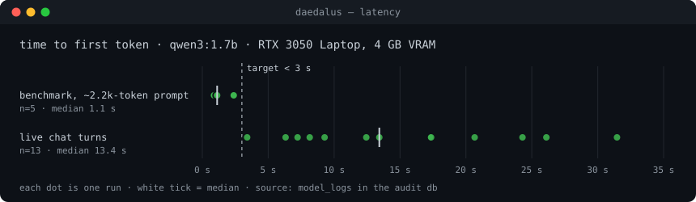</p>

<p align="center">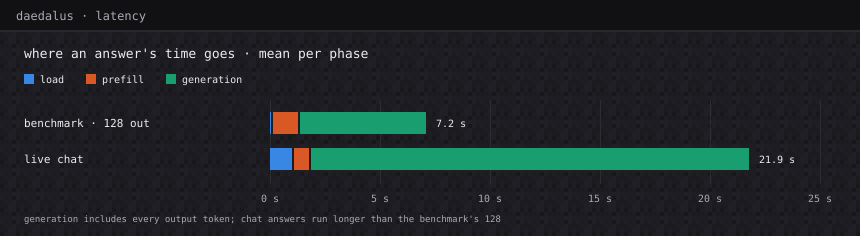</p>

| | runs | TTFT median | TTFT range | load | prefill | generation |
|:--|--:|--:|--:|--:|--:|--:|
| Benchmark, ~2.2k-token prompt, 128 tokens out | 5 | 1.1 s | 0.8 – 2.4 s | 0.1 s | 1.2 s | 5.8 s |
| Live chat turns | 13 | 13.4 s | 3.4 – 31.5 s | 1.1 s | 0.8 s | 20.0 s |
| Cloud baseline `gpt-oss:120b-cloud`, ~2.1k-token prompt | 2 | 1.4 s | 1.1 – 1.7 s | — | — | — |

<sub>Phase columns are means; the cloud API does not report phases. The cloud baseline is a labelled comparison, never production, and live chat excludes cloud turns.</sub>

**Reading it:**
- **Prefill is not the bottleneck.** Even with a full evidence pack it averages
  about a second; a bare question would flatter TTFT, so the benchmark uses a
  RAG-sized prompt on purpose.
- **Generation is.** Live chat spends ~20 s generating, against the
  benchmark's fixed 128 tokens, and live TTFT misses the **< 3 s** target by a
  wide margin. Closing that gap is open work, measured against this baseline.

**Against published numbers.** Measured figures for this exact setup
(qwen3:1.7b, Q4_K_M, a 4 GB laptop RTX 3050, a ~2k-token RAG prompt) don't
appear to be published. The closest is a *modelled estimate*, not a
measurement, of ~23.8 tok/s decode on the 8 GB desktop RTX 3050
([willitrunai](https://willitrunai.com/can-run/qwen-3-1.7b-on-rtx-3050-8gb)).
Daedalus measures **16.4 tok/s** (benchmark median) on the smaller laptop part.
That is context, not a like-for-like comparison. Fair comparisons are run here,
same machine and same prompt: more local models through the Forge's
*Benchmark both* are next.

Regenerate both charts from your own audit log with
`python3 .github/readme/build.py`. Method and caveats:
[`docs/BENCHMARK.md`](docs/BENCHMARK.md).

## Screenshots

<table>
  <tr>
    <th width="50%">Chat</th>
    <th width="50%">Ariadne's Thread</th>
  </tr>
  <tr>
    <td align="center">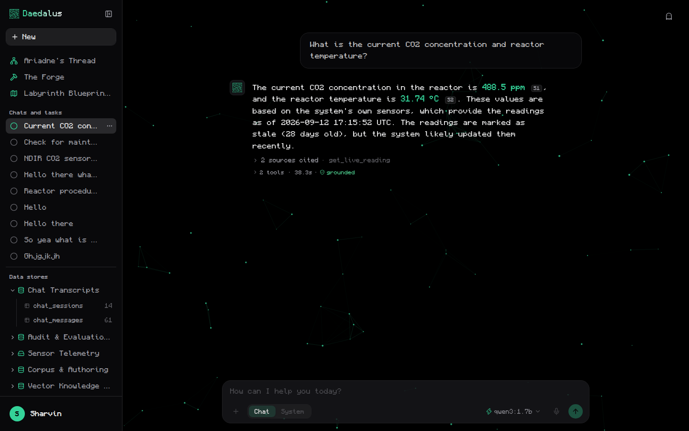<br><sub><samp>grounded answer with citation chips</samp></sub></td>
    <td align="center">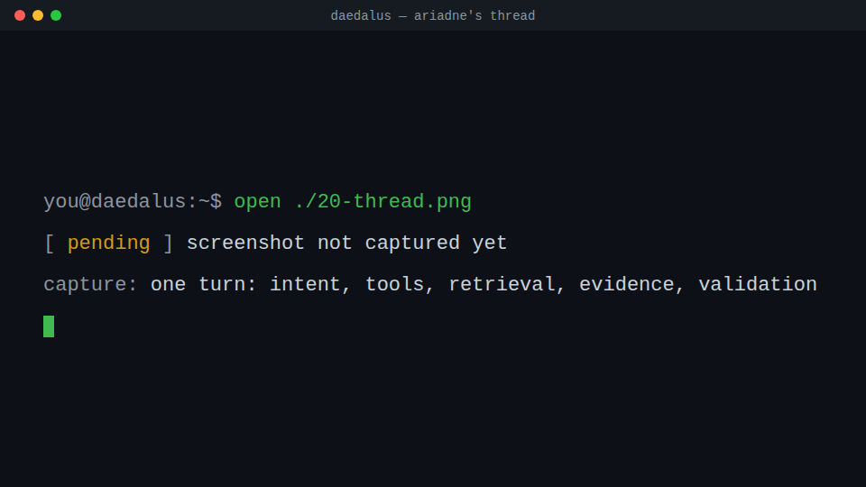<br><sub><samp>every step of one turn, every number checked</samp></sub></td>
  </tr>
  <tr>
    <th width="50%">The Forge · Hardware</th>
    <th width="50%">The Forge · Benchmark</th>
  </tr>
  <tr>
    <td align="center">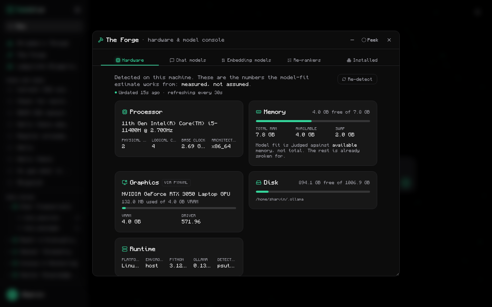<br><sub><samp>this machine's memory pools, scored for fit</samp></sub></td>
    <td align="center">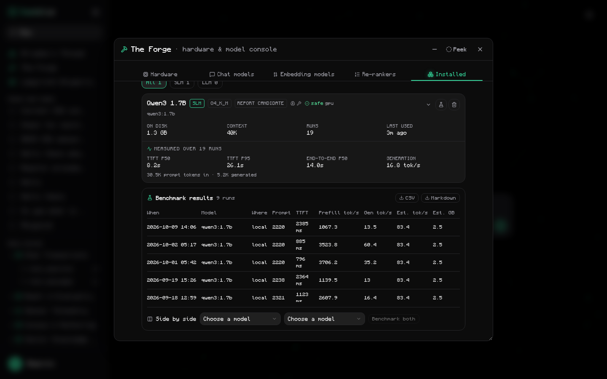<br><sub><samp>TTFT on a ~2k-token RAG prompt</samp></sub></td>
  </tr>
  <tr>
    <th width="50%">Labyrinth Blueprints</th>
    <th width="50%">Storage Health</th>
  </tr>
  <tr>
    <td align="center">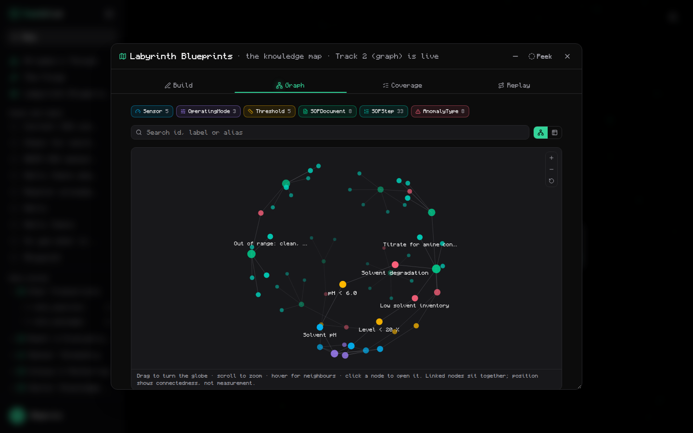<br><sub><samp>the 62-node knowledge graph</samp></sub></td>
    <td align="center">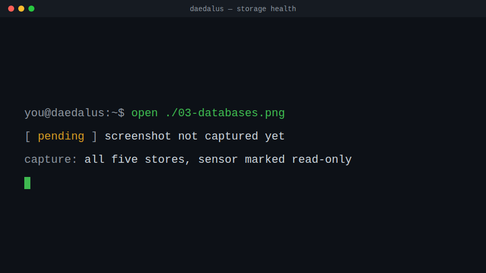<br><sub><samp>five stores, sensor read-only</samp></sub></td>
  </tr>
</table>

## Configuration

Everything lives in `.env`, created from [`.env.example`](.env.example) by
`setup`. It holds no secrets — nothing calls a cloud API until you add a
cloud endpoint in The Forge.

| Setting | Default |
|:--|:--|
| `BACKEND_PORT` / `FRONTEND_PORT` | `8000` / `5173` |
| `DAEDALUS_PORT` | `8000` (under `start`) |
| `OLLAMA_BASE_URL` | `http://localhost:11434` |
| `SEARXNG_URL` | `http://127.0.0.1:8081` |

To point Daedalus at a **real reactor database**, put it (or a symlink) at
`data/sqlite/sensor_readings.db`. It is opened read-only regardless.

## Troubleshooting

| Symptom | Fix |
|:--|:--|
| Chat can't answer, or the model picker is empty | Ollama isn't running or has no chat model: `ollama serve`, then `ollama pull qwen3:1.7b`. The rest of the dashboard works without it |
| `address already in use` on start | Something else holds the port. Set `BACKEND_PORT` / `FRONTEND_PORT` (for `dev`) or `DAEDALUS_PORT` (for `start`) in `.env` |
| Not sure what's missing | `./daedalus.sh doctor` — one table, with what to install for each failure |
| Sensor answers say there's no data | The sensor DB is empty. Settings → System → Storage Health → *Generate demo data* |
| Cloud models, Search or Integrations are missing | You're in Simple mode, the local-only default. Settings → General → **Advanced** |
| Broken after a `git pull` | `./sync.sh` — installs new deps, backfills `.env`, applies migrations |
| `reset.sh` refuses to run | Daedalus is still running. Stop it (Ctrl-C) first — deleting a live SQLite file corrupts it |

## Architecture

```text
Zone 1  physical reactor    sensors, ABV valves                 pre-existing
Zone 2  SCADA acquisition   CO2SorptionDT → SQLite              pre-existing
          │ read-only  ◄── the safety boundary
Zone 3  Daedalus            FastAPI · tools · RAG · Ollama      this project
Zone 4  presentation        React dashboard                     this project
```

Five separate stores, so a fault in ingestion or logging physically cannot
reach the sensor data of record:

| Store | Access | Holds |
|:--|:--|:--|
| **Sensor** `data/sqlite/sensor_readings.db` | **read-only** | Telemetry written by SCADA |
| **Audit** `logs/ai_logs.db` | append | Chat, tool, retrieval, model and error logs |
| **Chat** `data/sqlite/chat.db` | read/write | Transcripts — the user may delete these |
| **Vector** `data/chroma/` + `corpus.db` | read/write | Embedded chunks and what was ingested |
| **Prefs** `backend/data/prefs.db` | read/write | UI state |

Each writable store has numbered SQL migrations applied at startup.
Which files make up each feature: [`docs/CODE_MAP.md`](docs/CODE_MAP.md).

**Stack** — React 19 · TypeScript · Vite 8 · TanStack Router · Tailwind v4 ·
FastAPI · Pydantic · SQLite (WAL) · ChromaDB · NetworkX · Ollama · ONNX
cross-encoder re-rankers.

## Tests

```bash
(cd backend  && .venv/bin/python -m unittest discover -s tests -t .)   # 252 tests
(cd frontend && pnpm test)                                            # 13 tests
(cd frontend && npx tsc -b && pnpm lint)                              # typecheck + lint
```

Not in CI — run before a commit.

## Project layout

```text
frontend/      React dashboard — components, contexts, hooks, typed API client
backend/       FastAPI service — one package per module (chat, tools, blueprints,
               forge, thread, evaluation, system), each with a README; db/
config/        committed choices: model, retrieval track, graph, eval query set
docs/          all documentation — start at docs/README.md
scripts/       shared shell helpers, and the animated startup banner
data/ logs/    runtime databases (gitignored)
daedalus.sh    entry point — setup, dev, start, status, migrate
sync.sh        get a checkout working after a pull (safe)
reset.sh       wipe and rebuild the databases (destructive)
```

## Status

The software is built; the research result is not.

- **Corpus:** 17 collected documents ingested (887 chunks). **The lab's own
  documents are TBC** — not yet received.
- **Graph:** 62 nodes, authored from reference procedures; sensor data is demo.
- **Evaluation:** harness built and tested; the 30–50 question set and the
  three comparison runs are not done.

Plain-language progress: [`docs/STATUS.md`](docs/STATUS.md) · item by item: [`TODO.md`](TODO.md)

**Out of scope, deliberately:** cloud LLMs in production · any write path to
the plant · anomaly detection · auth/multi-tenancy · fine-tuning.

## Author

| | |
|:--|:--|
| **Author** | Sharvin A/L Kanesan |
| **Supervisor** | Ts. Dr Yew Kwang Hooi |
| **Programme** | Bachelor of Computer Science (Hons), Universiti Teknologi PETRONAS |
| **Project** | Final Year Project, 2026 |

## Credits

The dashboard's theme engine, settings shell and prefs API were modelled on
**[Odysseus](https://github.com/odysseus-dev/odysseus)** by Felix Kjellberg and
contributors. Daedalus is **not a fork**: no Odysseus source is in this repo,
and the React code was written from scratch. Full attribution:
[`ACKNOWLEDGMENTS.md`](ACKNOWLEDGMENTS.md).

## License

[MIT](LICENSE) © 2026 Sharvin A/L Kanesan

<sub>Banner, animations and charts generated by <code>python3 .github/readme/build.py</code>; animations and charts are set in <a href="https://github.com/IdreesInc/Monocraft">Monocraft</a> (SIL OFL 1.1), the dashboard's own face.</sub>
