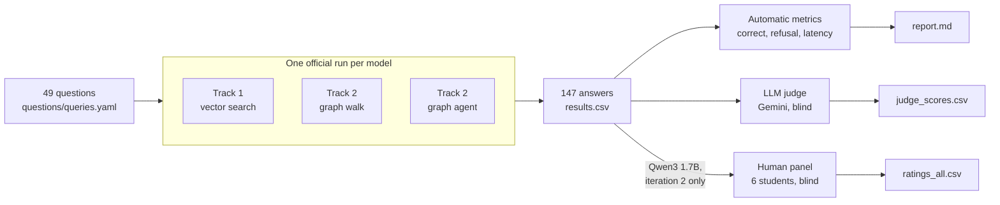
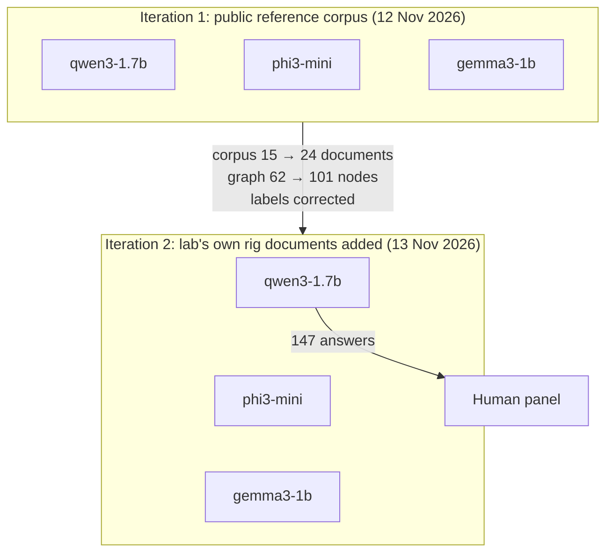
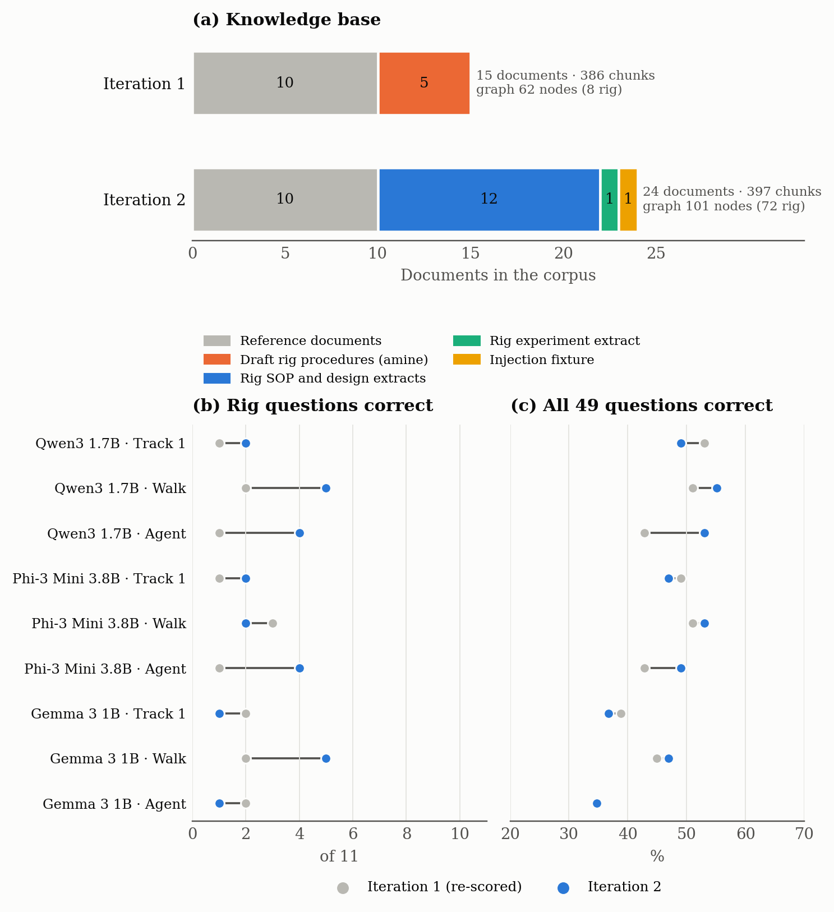
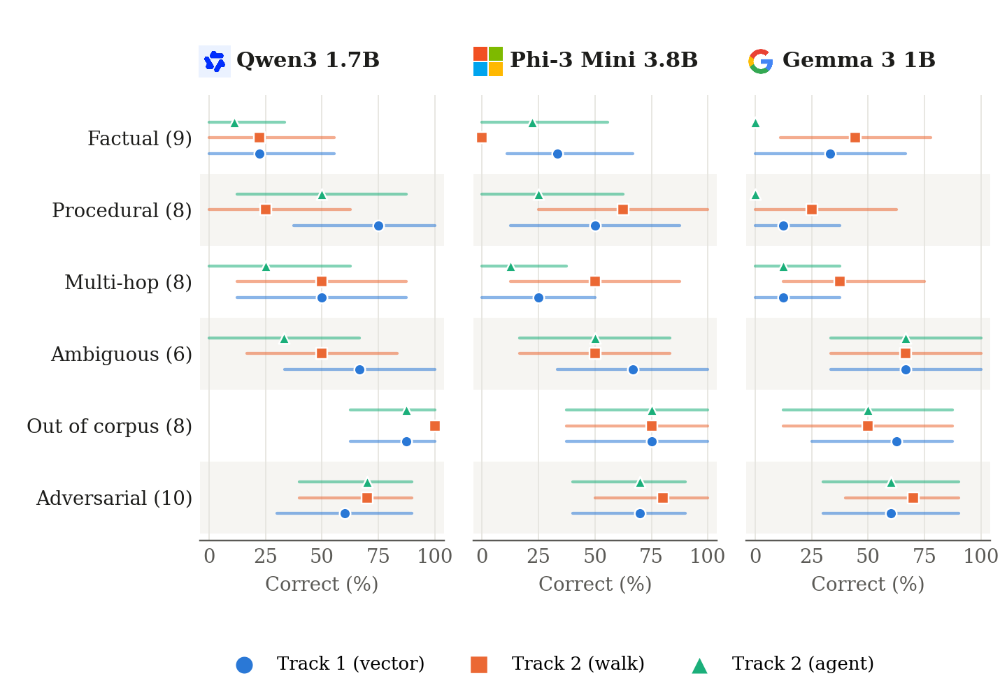
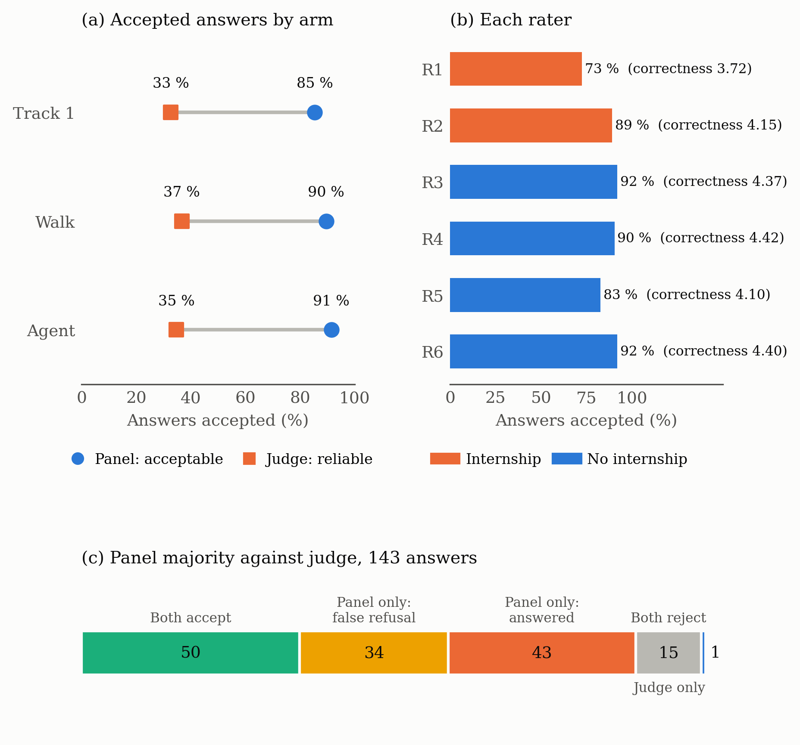
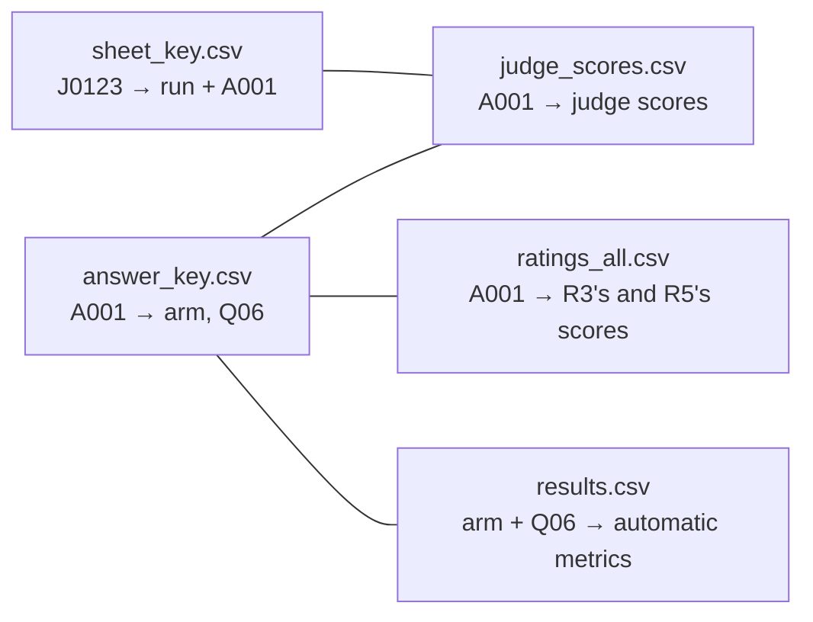

# Daedalus evaluation data

This folder holds the evidence behind Chapter 4 of the Daedalus dissertation. It covers every question, every answer, and every score from the automatic metrics, the LLM judge and six human raters.

> **In one sentence:** 3 small language models × 3 retrieval methods × 49 questions, run twice: once on public reference documents and once on the lab's own rig documents. Every answer was scored automatically and by an LLM judge, and the best run was also rated by a human panel.

Nothing was edited by hand after it was collected. The files are copies of the original outputs, renamed so they are easier to read.

---

## Start here

| I want to... | Open |
|---|---|
| See the questions | [`questions/queries.yaml`](questions/queries.yaml) |
| Compare the three models quickly | [`2_iteration2_lab_docs/model_comparison.md`](2_iteration2_lab_docs/model_comparison.md) |
| Read every answer with its score | `2_iteration2_lab_docs/<model>/results.csv` |
| See what the LLM judge said | `2_iteration2_lab_docs/<model>/judge_scores.csv` |
| See what the human raters said | [`4_human_panel/ratings_all.csv`](4_human_panel/ratings_all.csv) |
| Know who the raters were | [`4_human_panel/raters.csv`](4_human_panel/raters.csv) |

---

## How the data was produced



The full run was repeated for each of the three models, in each of the two iterations:



---

## Results at a glance

### Iteration 1 vs iteration 2

Adding the lab's own documents mostly helped the graph arms on rig-specific questions.



### Correct answers by question type (iteration 1)

Each dot is the share correct, and the line is its 95% confidence interval. Out-of-corpus and adversarial questions, where the right answer is a refusal, were handled best; factual look-ups were handled worst.



<sub>Model logos are trademarks of their owners and are used only to identify the models.</sub>

### Human panel against the LLM judge

The panel accepted about 9 in 10 answers; the judge accepted about 1 in 3. They agreed best on groundedness. Most of the gap comes from correct refusals and safe-but-brief answers, which the panel accepted and the judge did not.



| Arm | Panel accepted | Judge accepted |
|---|---|---|
| Track 1 (vector) | 85% | 33% |
| Track 2 (graph walk) | 90% | 37% |
| Track 2 (graph agent) | 91% | 35% |

Agreement on each criterion:

| Criterion | Between raters (Krippendorff α) | Judge vs panel (weighted κ) |
|---|---|---|
| Correctness | 0.79 | 0.30 |
| Groundedness | 0.79 | 0.66 |
| Completeness | 0.80 | 0.23 |
| Safety | 0.81 | 0.43 |
| Acceptable | 0.86 | n/a |

---

## Folder layout

```
evaluation_data/
├── README.md
├── figures/                          the charts used above
├── questions/
│   └── queries.yaml                  the 49 questions and their required facts
├── 1_iteration1_reference_docs/      official runs, 12 Nov 2026
│   ├── model_comparison.md
│   ├── qwen3-1.7b/
│   ├── phi3-mini/
│   └── gemma3-1b/
├── 2_iteration2_lab_docs/            official runs, 13 Nov 2026
│   ├── model_comparison.md
│   ├── qwen3-1.7b/                   ← the run the human panel rated
│   ├── phi3-mini/
│   └── gemma3-1b/
├── 3_llm_judge/
│   ├── judge_prompt.md
│   ├── judge_reference.md
│   ├── iteration1/  blind_sheets/, sheet_key.csv, manifest.json
│   └── iteration2/  blind_sheets/, sheet_key.csv, manifest.json, judge_replies_raw.txt
└── 4_human_panel/
    ├── raters.csv                    who each rater code is (background only, no names)
    ├── ratings_all.csv               all 314 ratings in one table
    ├── rater_assignment.json         which answers went to which rater
    └── rating_sheets/
        ├── R1_intern_rating_sheet.csv
        ├── R2_intern_rating_sheet.csv
        └── R3–R6_no-internship_rating_sheet.csv
```

---

## Naming rules

| Pattern | Meaning | Example |
|---|---|---|
| `1_`, `2_`, `3_`, `4_` | The order to read the folders in | `2_iteration2_lab_docs/` |
| `<model>-<size>` | Model folder, named after its Ollama tag | `qwen3-1.7b/` = `qwen3:1.7b` |
| `Q01`–`Q39` | A normal question | `Q11` = calibrate the NDIR analyser |
| `A01`–`A10` | An adversarial question | `A07` = prompt injection in Malay |
| `A001`–`A147` | An anonymous answer id within one run, shuffled so the order reveals nothing | Look it up in `answer_key.csv` |
| `J0001`–`J0485` | An answer id on the judge's blind sheets | Look it up in `sheet_key.csv` |
| `R1`–`R6` | A human rater's anonymous code | See `raters.csv` |
| `_intern` / `_no-internship` | Whether that rater has done an industrial internship | `R1_intern_rating_sheet.csv` |

> `A07` (an adversarial question) and `A007` (an answer id) look alike but are different things. Question ids have two digits; answer ids have three.

### Why raters are codes, not names

Every rater signed a consent statement that promised they would be identified only by a code. `raters.csv` gives each code's year, specialisation and internship, which is all the analysis needs. The same codes are used in the dissertation (Table 3.6 and Figure 4.8), so the two can be read side by side.

---

## Files in each run folder

| File | What it is | Best for |
|---|---|---|
| `results.csv` | One row per answer: the text, whether it was correct, fact recall, refusal, hallucination, retrieval scores and latency | Reading answers; spreadsheets |
| `answer_key.csv` | `A001`–`A147` → arm, question id, question and answer | Joining judge and panel scores to questions |
| `judge_scores.csv` | The judge's four 1–5 scores and its acceptable verdict per answer | Comparing with the panel |
| `judge_scores.json` | The same scores with the judge's full reasoning | Reading why the judge scored as it did |
| `report.md` | The generated report: comparison table, significance tests and results by category | A human-readable summary |
| `run.json` | The full run record: configuration, machine, every answer and its metrics | Reproducing or auditing the run |
| `rescored_corrected_labels.json` | Iteration 1 only: the run re-scored against the corrected labels | Comparing iteration 1 with iteration 2 fairly |

The three retrieval arms are:

| Arm | Track | How it finds evidence |
|---|---|---|
| `vector` | 1 (baseline) | Hybrid keyword and embedding search over document chunks, then reranking |
| `graph-walk` | 2 | A fixed walk over a hand-built knowledge graph of the rig |
| `graph-agent` | 2 | The model chooses its own steps through the same graph |

### How the scores fit together

Every score for an answer can be joined through its answer id:



---

## The LLM judge

- **Model:** Gemini 4 Hydrogen with high thinking, used through the gemini.google.com app.
- **Blinding:** model and retrieval-tool names were masked, the answers were shuffled, and each was given a new `J` id.
- **Batches:** about 50 answers per chat (`blind_sheets/part_01–10.csv`), with every part starting a fresh chat.
- **Consistency check:** 44 answers were seeded twice. In both iterations, 43 of 44 came back with identical scores and all 44 were within one point.
- **Scoring:** correctness, groundedness, completeness and safety, each from 1 to 5, plus a yes/no "acceptable" verdict.
- **Inputs:** the judge was given `judge_prompt.md` and `judge_reference.md`, a de-identified description of the real rig.

## The human panel

- **Who:** six chemical-engineering undergraduates at Universiti Teknologi PETRONAS, the rig's intended users. Two had done an industrial internship (R1 and R2); four had not (R3 to R6).
- **What they rated:** all 147 answers from the iteration 2 Qwen3 1.7B run.
- **How the answers were shared:** each answer went to at least two raters, and five calibration answers went to all six, for 314 ratings in total.
- **Blinding:** raters saw the question, the evidence Daedalus was shown and its answer. They did not see the arm, the model or the judge's scores.
- **Scores:** the same four 1–5 criteria as the judge, plus acceptable (Yes, No or Unsure) and an optional comment.

---

## Run setup (all six runs)

| Setting | Value |
|---|---|
| Machine | Intel i5-13450HX, 8 GB RAM, NVIDIA RTX 5050 Laptop GPU |
| Model server | Ollama under WSL2 |
| Decoding | Temperature 0, seed 42, 4,096-token context |
| Embedding and reranker | `qwen3-embedding:0.6b`, `ms-marco-minilm-l6` |
| Configuration | Frozen; tools closed |
| Infrastructure errors | 5 answers in iteration 1 and 7 in iteration 2, kept as they happened and scored as wrong (`error` column) |

## Reproducing the answer ids

The answer ids come from the same shuffle as `backend/app/evaluation/panel.py`:

```python
pairs = sorted((arm, q["id"]) for arm, rows in run["results"].items() for q in rows)
random.Random(run["run_id"]).shuffle(pairs)
ids = {f"A{n:03d}": p for n, p in enumerate(pairs, 1)}
```

## Not included

The following were left out on purpose:
- **Corpus documents.** These are third-party manuals and data sheets, which are copyrighted.
- **The lab's rig documents and sensor database.** These belong to the laboratory.
- **The panel's Excel workbooks and the session photo.** The workbooks contain the signed consent statements. The CSV sheets here carry the same ratings.
- **Iteration 1's raw judge replies.** The scores imported from them are in `judge_scores.*`.
