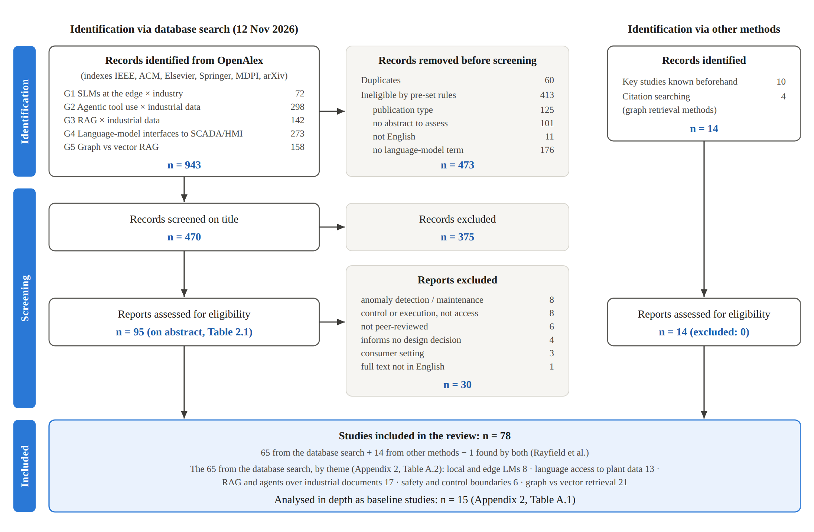

# Systematic literature review

This folder holds the record behind the systematic literature review in Chapter 2 of the Daedalus dissertation. It contains the search queries, a decision for every record found, and the 65 studies that were included. The review follows the PRISMA 2020 reporting guideline.



## Files

| File | Contents |
|---|---|
| `included_studies.csv` | The 65 included studies: theme, title, year, venue and DOI |
| `screening_decisions.csv` | All 883 unique records, each with the stage it reached, the decision and the reason |
| `prisma_flow.png` | The PRISMA flow diagram (Figure 2.1 in the dissertation) |
| `scripts/1_search_openalex.py` | Runs the five queries on OpenAlex and saves every record |
| `scripts/2_rule_screening.py` | Removes duplicates and applies the pre-set exclusion rules |

## The search

The search was run on **12 November 2026** on [OpenAlex](https://openalex.org), which indexes IEEE, ACM, Elsevier, Springer, MDPI and arXiv. It covered titles and abstracts published from 2023 to 2026.

| Group | Concept | Records |
|---|---|---|
| G1 | On-device or small language models in industry | 72 |
| G2 | Agentic tool calling over industrial data | 298 |
| G3 | RAG over industrial or IoT data | 142 |
| G4 | Language interfaces to SCADA or HMI | 273 |
| G5 | Graph-based against vector retrieval | 158 |

<details>
<summary>The exact query strings</summary>

```
G1  ("small language model" OR "on-device language model" OR "edge LLM") AND (industrial OR IoT OR SCADA OR sensor)
G2  ("tool calling" OR "function calling" OR "LLM agent" OR ReAct) AND (SCADA OR "industrial IoT" OR IIoT OR "sensor data")
G3  ("retrieval-augmented generation" OR RAG) AND (SCADA OR "industrial IoT" OR IIoT OR "sensor data" OR "process plant")
G4  ("large language model" OR LLM OR chatbot OR conversational) AND (SCADA OR HMI OR "human-machine interface")
G5  ("GraphRAG" OR "graph RAG" OR "graph retrieval-augmented generation") AND ("vector RAG" OR versus OR comparison OR "systematic evaluation")
```
</details>

## How records were screened

| Stage | In | Excluded | Main reasons |
|---|---|---|---|
| Identified | 943 | 60 duplicates | Same DOI or title |
| Automated rules | 883 | 413 | Not about language models (176), ineligible publication type (125), no usable abstract (101), not English (11) |
| Title screening | 470 | 375 | Off-topic on title |
| Eligibility (abstract) | 95 | 30 | Anomaly detection or maintenance only (8), control rather than information access (8), not peer-reviewed (6), no design relevance (4), consumer setting (3), full text not in English (1) |
| **Included** | **65** | | |

The `stage`, `decision` and `reason` columns of `screening_decisions.csv` record each step. Title and abstract decisions were made with the help of an AI tool and checked by the author against this log.

## Included studies by theme

| Theme | Focus | Studies |
|---|---|---|
| T1 | Local and edge language models in industrial or IoT settings | 8 |
| T2 | Natural-language access to plant, sensor or SCADA data | 13 |
| T3 | RAG and agents over industrial documents and operations | 17 |
| T4 | Safety and control boundaries for LLMs in industrial systems | 6 |
| T5 | Graph versus vector retrieval | 21 |

Fifteen studies were analysed in depth as baseline studies (Table A.1 of the dissertation). Some of these were identified before the search, and four graph-retrieval methods were found by following citations.

## Re-running the search

```bash
python3 scripts/1_search_openalex.py   # writes identified.json (needs internet)
python3 scripts/2_rule_screening.py    # writes unique.json and prints the rule-based counts
```

OpenAlex keeps adding records, so a later run will return more than the counts above. The decision log is the record of the run on 12 November 2026. The downloaded records are not included here, because they contain the publishers' abstracts.
